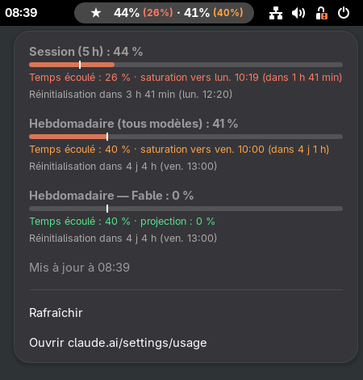

# Claude Usage

Extension GNOME Shell qui affiche dans la barre du haut l'utilisation des
limites Claude (session 5 h, hebdomadaire), avec le rythme de consommation
par rapport au temps déjà écoulé dans chaque créneau.



## Fonctionnement

- Lit le jeton OAuth dans `~/.claude/.credentials.json` (celui de Claude Code).
- Interroge `https://api.anthropic.com/api/oauth/usage`.
- Affiche dans la barre : `usage% (temps écoulé%)` pour la session et la semaine,
  coloré en vert/orange/rouge selon l'écart entre les deux.
- Le menu détaille chaque limite : barre de progression, repère du temps
  écoulé, projection à la réinitialisation au rythme actuel.

## Installation

```bash
cp -r . ~/.local/share/gnome-shell/extensions/claude-usage@desconnets.fr
gnome-extensions enable claude-usage@desconnets.fr
```

Sous Wayland, une nouvelle extension n'est prise en compte qu'après
déconnexion/reconnexion de la session.

## Prérequis

Avoir utilisé `claude` (Claude Code) au moins une fois, pour que
`~/.claude/.credentials.json` existe avec un jeton valide.
